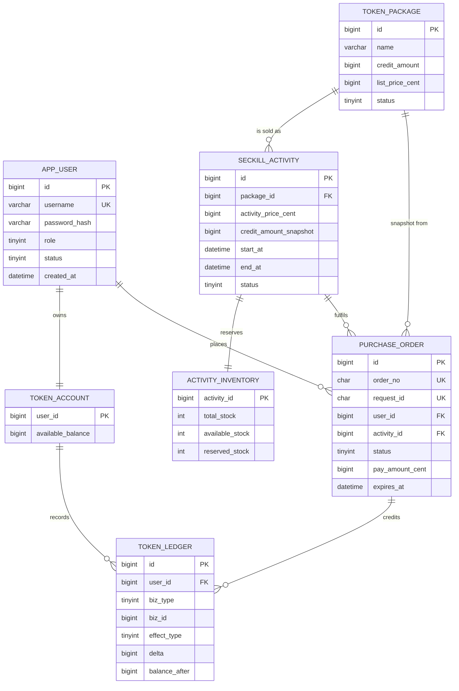

# TokenX 数据库设计（F0-3 评审稿）

> **状态**：设计评审稿，**不是已实现、未压测**的结构。文中所有吞吐数字均为容量推算或目标值，**未做实测**，统一标注「推算/待验证」。
> **输入材料**：`docs/TokenX_db.md`（V3 设计稿，用户提供）、`docs/PROJECT_SPEC.md` §5/§6/§7、`docs/ENGINEERING_STANDARDS.md` §5、黑马点评源码实读记录（见 `docs/REFERENCE_MAPPING.md`）。
> **本文地位**：本文是**决策版本**；`docs/TokenX_db.md` 保留为评审输入原稿。两者冲突时以本文「§10 冲突与推荐」的决议为准。
> **本轮不做**：不建表、不写迁移 SQL、不写 Mapper/Service、不改业务代码。

---

## 0. 结论摘要

| # | 决策 | 结论 |
|---|---|---|
| 1 | 表数量 | **7 张**：`app_user`、`token_package`、`seckill_activity`、`activity_inventory`、`purchase_order`、`token_account`、`token_ledger` |
| 2 | 活动配置与库存 | **分表**，理由是写频率隔离，不是为了"看起来规范"（见 §4.4） |
| 3 | 普通购买与秒杀订单 | **共用 `purchase_order`**；`activity_id` 可空 + `order_type` 区分。**已定方案 B**：接口与 Service 分开，表共用（§15） |
| 4 | 库存已售量 `sold_stock` | **不落库**，由 `total - available - reserved` 计算 |
| 5 | 秒杀限购 | 靠 `UNIQUE(activity_id, user_id)`，**不建** `purchase_qualification` |
| 6 | 模拟支付流水 | **不建** `payment_record`；真实网关接入时另建 `payment_transaction` |
| 7 | 订单对外编号 | **保留 `order_no`**（SPEC 要求），PK 仍是紧凑自增 `id` |
| 8 | 用户角色 | V3 稿缺 `role`，**必须补上**，否则管理员接口无法鉴权 |
| 9 | 分库分表 / 库存分桶 / 订单分区 | **全部不做**，触发条件见 §9 |
| 10 | 异步链路 | V1 不引入；Redis 只做准入过滤，Kafka 只在 V1.5 有独立下游时才进（§8） |
| 11 | 普通购买与秒杀 | **接口分、Service 分、表不分**：两个下单入口 + 两个 Service，共用 `purchase_order`；不手写单例、不提前上策略模式（§15） |

---

## 1. 业务边界与核心业务规则

### 1.1 V1 业务闭环

1. 注册 / 登录（用户名 + 密码），角色：普通用户、管理员。
2. 套餐（`token_package`）浏览与详情；管理员上下架。
3. 限时秒杀活动（`seckill_activity`）创建、发布、下架；库存初始化。
4. 用户在活动时间内抢购 → 生成**待支付订单**（预占库存）。
5. 模拟支付 → 订单 `PAID` + 库存转已售 + Token 额度入账（同一本地事务）。
6. 超时关闭 → 订单 `CLOSED` + 释放预占库存。
7. 查询：我的订单、钱包余额、额度流水。
8. **普通购买**（无活动、无库存约束、可重复购买）——已确认纳入 V1（Q1，方案 B），排在秒杀通路之后实现。

非目标：真实支付、真实模型调用计费、退款、提现、社区、微服务。

### 1.2 必须由数据库兜底的不变量

| 编号 | 不变量 | 数据库层保障 |
|---|---|---|
| I1 | 库存不为负、不超卖 | `UNSIGNED` + 条件 UPDATE（`WHERE available_stock > 0`）+ 检查影响行数 |
| I2 | `available + reserved + paid = total` | 三量同事务更新；`CHECK (available + reserved <= total)` 兜底 |
| I3 | 一人一活动最多一单 | `UNIQUE(activity_id, user_id)` |
| I4 | 同一请求重试不产生第二单 | `UNIQUE(request_id)` |
| I5 | 订单状态单向迁移 | 条件 UPDATE `WHERE status = 0`，检查影响行数为 1 |
| I6 | 同一订单只入账一次 | `UNIQUE(biz_type, biz_id, effect_type)` |
| I7 | 余额不为负 | `BIGINT UNSIGNED` + 条件更新 |
| I8 | 已支付订单不可被关单 | `status=0` 条件更新天然互斥 |

### 1.3 订单状态机（只允许这两条边）

```text
UNPAID(0) ──支付成功──> PAID(1)
    └──────超时/取消──> CLOSED(2)
PAID / CLOSED 为终态，V1 无退款，不可回退。
```

### 1.4 活动状态：配置态与运行态分离

- `seckill_activity.status` 只表示**配置/发布状态**：`0=DRAFT`、`1=PUBLISHED`、`2=OFFLINE`。
- "未开始 / 进行中 / 已结束"是**运行态**，由 `start_at`、`end_at` 与服务端当前时间计算，**不落库**（落库就需要定时任务改状态，且必然与真实时间漂移）。
- 抢购时两种状态都要校验：`status=1` 且 `now ∈ [start_at, end_at)`。

---

## 2. 压测负载模型与性能目标（全部待验证）

### 2.1 场景定义

| 场景 | 输入 | 主要考察 |
|---|---|---|
| S1 极端争抢 | 20,000 个不同用户争抢 1,000 份库存 | 拒绝路径成本、单行锁排队、P99 尾延迟 |
| S2 高有效写入 | 20,000 个不同用户，库存 20,000 | 订单 TPS、索引写放大、redo/WAL 压力 |
| S3 多活动并行 | 10 场活动同时抢购，各自库存充足 | 热点是否被隔离到不同库存行 |
| S4 混合负载 | 下单 + 支付 + 超时关单 + 查单 同时发生 | 死锁率、锁等待、跨表事务长度 |

### 2.2 三个指标必须分开报（禁止混为一谈）

| 指标 | 定义 | 对应组件 |
|---|---|---|
| 入口 QPS | 客户端发起抢购请求的速率，**包含必然失败的请求** | Web 层 / Redis |
| 订单创建 TPS | 数据库成功提交 `purchase_order` 的速率 | MySQL 写路径 |
| 支付完成 TPS | 订单成功迁移到 `PAID` 且账本落库的速率 | MySQL 多表事务 |

> S1 中入口 QPS 可以很高而订单 TPS 只有库存量级（1,000）。把 20,000 QPS 说成"支撑 2 万订单"是错误结论。

### 2.3 容量推算模型（**假设透明，非实测结果**）

单活动库存行的写入等价于**串行**（同一行行锁）。设：

- `t_tx` = 一个下单事务从取到库存行锁到提交释放的时间；
- `N` = 该事务内二级索引维护次数（`purchase_order` 约 5 个）。

则 **单活动订单 TPS 上限 ≈ 1 / t_tx**（组提交可提升有效吞吐，因此该式偏保守）。

| 假设的 `t_tx` | 单活动订单 TPS 上限（推算） | 说明 |
|---|---|---|
| 0.3 ms | ~3,300 | 本机 SSD、无竞争、单条 UPDATE + 单条 INSERT |
| 1.0 ms | ~1,000 | 含 5 个二级索引维护 + fsync 抖动 |
| 3.0 ms | ~330 | 出现明显锁等待或磁盘抖动 |

**这些数字不可当作结论**，只用于说明：瓶颈是"单行锁 + 每次提交的索引写"，不是"表有多少行"。真实值必须在 S1/S2 下用 k6 实测，并同时报告机器规格、并发数、库存、到达率（见 §2.4）。

### 2.4 性能目标（待验证，允许被实测推翻）

| 指标 | 目标 | 验证方式 |
|---|---|---|
| 正确性 | S1 下有效订单数 ≤ 库存；无超卖；一人一单 | 压测后跑 §6.4 对账 SQL，结果必须为空 |
| 入口 QPS | A 阶段不作承诺；B 阶段目标 ≥ 5,000（待验证） | k6 固定到达率 |
| 订单 TPS | A 阶段单活动 ≥ 500（待验证） | MySQL `Com_insert` / 应用计数器 |
| 尾延迟 | 下单接口 P99 ≤ 300 ms（A 阶段，待验证） | k6 `http_req_duration` |
| 错误率 | < 0.1%（除业务拒绝外） | k6 失败率 |
| 死锁 | S4 下 0 致命失败（允许重试成功） | `SHOW ENGINE INNODB STATUS` |

---

## 3. 数据模型总览

### 3.1 实体关系



### 3.2 不建的表及理由（重要：克制）

| 候选表 | 决定 | 理由 | 何时再谈 |
|---|---|---|---|
| `purchase_qualification` | **不建** | `UNIQUE(activity_id,user_id)` 已唯一表达"一人一单"，再建一张表等于同一事实存两份，必然出现不一致 | 若将来要记录"参与但未中签"的抽签结果，才需要独立资格表 |
| `payment_record` | **不建** | V1 是模拟支付，没有任何外部支付单号/回调报文要落库；状态已在订单上 | 接入真实网关时建 `payment_transaction`（外部单号唯一、回调幂等） |
| `outbox_event` / `processed_message` | **不建** | 当前没有独立下游消费者；引入只会增加一个必须与业务同事务写的热点表 | V1.5 有真实独立下游事件时（F8） |
| `seckill_request` | **不建** | 同步链路里"请求"与"订单"是同一件事；只有当"受理"与"落单"分离（C 阶段）才有独立价值 | C 阶段且需要跨重启查排队状态时（§8.2） |
| `schema_probe` | **F1 拆除** | F0-2 的连通性探针，不是业务表 | 随 `V3` 迁移一并删除 |

---

## 4. 逐表设计

> 通用约定：字符集 `utf8mb4` / 排序规则 `utf8mb4_0900_ai_ci`（`request_id`、`order_no` 用 `ascii_bin`）；时间统一 `DATETIME(3)` 存 **UTC**（连接参数已设 `connectionTimeZone=UTC`）；金额与额度一律整数最小单位，禁止浮点。

### 4.1 `app_user` —— 账号主体

**职责与必要性**：登录凭据与身份的唯一来源。V3 稿缺 `role`，必须补：管理员接口（建套餐、建活动）需要角色判定，不能靠"用户 ID 等于 1"这类约定。

| 字段 | 类型 | NULL | 默认 | 说明 |
|---|---|---|---|---|
| `id` | `BIGINT UNSIGNED` | NO | AUTO_INCREMENT | 内部主键，聚簇索引 |
| `username` | `VARCHAR(64)` | NO | — | 登录名，唯一；长度 3–64，仅字母数字下划线 |
| `password_hash` | `VARCHAR(255)` | NO | — | BCrypt 输出（60 字符）；留长度余量便于换算法，**绝不存明文** |
| `role` | `TINYINT` | NO | 0 | 0=USER，1=ADMIN |
| `status` | `TINYINT` | NO | 0 | 0=ACTIVE，1=DISABLED（禁用后不可登录） |
| `created_at` | `DATETIME(3)` | NO | `CURRENT_TIMESTAMP(3)` | UTC |
| `updated_at` | `DATETIME(3)` | NO | `CURRENT_TIMESTAMP(3)` ON UPDATE | UTC |

**键与约束**

- `PRIMARY KEY (id)`
- `UNIQUE KEY uk_user_username (username)`
- 用户名大小写：`utf8mb4_0900_ai_ci` 下 `Alice` 与 `alice` 视为同一用户（防冒名）。**这是产品决策**，见 §12 问题 Q4。

**查询与索引**

| 场景 | SQL | 命中索引 |
|---|---|---|
| 注册 | `INSERT INTO app_user(username,password_hash,role,status) VALUES(?,?,0,0)` | `uk_user_username` 冲突即"已存在" |
| 登录 | `SELECT id,password_hash,role,status FROM app_user WHERE username=?` | `uk_user_username`（唯一索引等值，回表 1 次） |
| 当前用户 | `SELECT ... FROM app_user WHERE id=?` | 主键 |

只保留 1 个二级索引。**不建** `status` 索引：V1 没有"按状态列用户"的查询；真要做后台筛选时再按 `EXPLAIN` 加。

**读写与热点**：注册/登录低频，无锁竞争。**冗余与派生**：不放余额、订单数（余额在 `token_account`，统计需要时再算）。

**简化/过度设计检查**：`email`、`last_login_at`、`updated_by` 均不加——当前无需求。

---

### 4.2 `token_package` —— 套餐主数据

**职责与必要性**：定义"卖什么"（额度 + 标价）。活动只是对它的限时售卖，二者生命周期不同，必须分开。

| 字段 | 类型 | NULL | 默认 | 说明 |
|---|---|---|---|---|
| `id` | `BIGINT UNSIGNED` | NO | AUTO_INCREMENT | |
| `name` | `VARCHAR(96)` | NO | — | 展示名 |
| `credit_amount` | `BIGINT UNSIGNED` | NO | — | 购买后到账额度（整数单位） |
| `list_price_cent` | `BIGINT UNSIGNED` | NO | — | 标价（分） |
| `status` | `TINYINT` | NO | 0 | 0=OFF_SHELF，1=ON_SALE |
| `created_at` / `updated_at` | `DATETIME(3)` | NO | 同上 | |

**键与约束**：`PRIMARY KEY(id)`；`KEY idx_package_status (status)`（列表页 `WHERE status=1 ORDER BY id DESC`，InnoDB 二级索引自带主键，无需再写 `(status,id)`）。

**查询**：`SELECT ... WHERE status=1 ORDER BY id DESC LIMIT ?` → `idx_package_status`；详情 `WHERE id=?` → 主键；管理端全量列表 → 主键扫描（表小，量级百级）。

**读写与热点**：读多写少，缓存友好（F7 可做 Cache-Aside）。无并发写竞争。

**冗余**：不冗余活动价。活动价与库存是活动快照，见 §4.3。

**过度设计检查**：不加 `stock`（库存属于活动，属于 `activity_inventory`）、不加 `sales_count`（可由订单聚合，且会成为写热点）。

---

### 4.3 `seckill_activity` —— 活动配置（低频写）

**职责与必要性**：表达"某套餐在某个时间窗、以某个价格、限量售卖"。价格与额度在发布时**快照**，之后套餐改价不影响历史订单。

| 字段 | 类型 | NULL | 默认 | 说明 |
|---|---|---|---|---|
| `id` | `BIGINT UNSIGNED` | NO | AUTO_INCREMENT | |
| `package_id` | `BIGINT UNSIGNED` | NO | — | 指向 `token_package` |
| `activity_price_cent` | `BIGINT UNSIGNED` | NO | — | 活动价快照（分） |
| `credit_amount_snapshot` | `BIGINT UNSIGNED` | NO | — | 到账额度快照 |
| `start_at` / `end_at` | `DATETIME(3)` | NO | — | 服务端时间，UTC；`start_at < end_at` |
| `status` | `TINYINT` | NO | 0 | 0=DRAFT，1=PUBLISHED，2=OFFLINE |
| `created_at` / `updated_at` | `DATETIME(3)` | NO | 同上 | |

**键与约束**：`PRIMARY KEY(id)`；`KEY idx_activity_list (status, start_at)`（首页"进行中/即将开始"：`WHERE status=1 AND end_at > ? ORDER BY start_at`，前缀 `status` 等值 + `start_at` 有序，`end_at` 作过滤残余）；`CHECK (start_at < end_at)`。

**明确不加**：`version`（SPEC 曾提及）。理由：该行在秒杀期间**不被更新**（库存与成交不进这张表），管理员编辑是低频操作，乐观锁解决的是并不存在的争用；真出现"两人同时改活动"的需求再加。**不加** `sold_count` / `participant_count`：那会把高频写引到低频行上，且与 `activity_inventory` 的计数重复。

**读写与热点**：读多写极少。缓存首选对象（F7）。无锁竞争。

**冗余**：`credit_amount_snapshot`、`activity_price_cent` 是刻意的快照冗余——它们**不可由 `token_package` 计算得到**（套餐可能改价），因此不是坏冗余。

---

### 4.4 `activity_inventory` —— 库存热点行

**职责与必要性（为什么值得单独一张表）**

1. **写频率隔离**：这一行每次抢购都被 UPDATE，而 `seckill_activity` 几乎只读。合表会让"高频行锁"与"配置读取"共享同一行，并把 binlog/undo 压力带给配置表。
2. **访问形态不同**：库存永远按 `activity_id` 点查/点更新；配置按状态 + 时间做列表扫描。索引需求不兼容。
3. **代价透明**：多一次按主键的 1:1 join，成本约等于一次页内查找（**推算，待验证**），远小于锁竞争带来的收益。

反方（也成立）：单活动 QPS 低时合表更简单。**结论**：保留分表，但若将来发现"活动详情页 join 成为瓶颈"，可把只读库存快照缓存到 Redis（F7），而不是合表。

| 字段 | 类型 | NULL | 默认 | 说明 |
|---|---|---|---|---|
| `activity_id` | `BIGINT UNSIGNED` | NO | — | 主键，与活动 1:1 |
| `total_stock` | `INT UNSIGNED` | NO | — | 发布时固定，后续不可改（改了就无法对账） |
| `available_stock` | `INT UNSIGNED` | NO | — | 可预占 |
| `reserved_stock` | `INT UNSIGNED` | NO | — | 待支付占用 |
| `updated_at` | `DATETIME(3)` | NO | `CURRENT_TIMESTAMP(3)` ON UPDATE | |

**键与约束**：`PRIMARY KEY(activity_id)`；`CHECK (available_stock + reserved_stock <= total_stock)`。

**`sold_stock` 为什么不要**：`sold = total - available - reserved`，是纯派生量。多存一份就多一次写、多一个可能与事实不符的字段；对账时反而要判断"哪一份才对"。

**索引**：**只有主键**。这一行的高频更新若再挂二级索引，每次 UPDATE 都要维护索引项并可能产生额外随机 IO，收益为零（没有按库存查询的场景）。

**读写与热点**：**全系统唯一真正的行级热点**。单活动内所有抢购在此串行。不同活动落在不同行（`activity_id` 主键），因此 S3 场景可并行——这正是分表带来的隔离收益。

**简化方案**：不做库存分桶（§9），不在行内存 JSON，不预留 `locked_stock` 等多余状态。

---

### 4.5 `purchase_order` —— 订单（写入最热的表）

**职责与必要性**：交易事实的唯一载体。普通购买与秒杀共用一张表：状态机、支付、入账、查单逻辑完全相同，拆两张表会导致支付/钱包双份代码与双份事务。

| 字段 | 类型 | NULL | 默认 | 说明 |
|---|---|---|---|---|
| `id` | `BIGINT UNSIGNED` | NO | AUTO_INCREMENT | 紧凑聚簇主键，插入顺序即时间顺序 |
| `order_no` | `CHAR(26)` ascii_bin | NO | — | 对外单号（不可枚举），`UNIQUE` |
| `request_id` | `CHAR(36)` ascii_bin | NO | — | 客户端 `Idempotency-Key`，`UNIQUE` |
| `user_id` | `BIGINT UNSIGNED` | NO | — | 下单人，来自认证上下文 |
| `package_id` | `BIGINT UNSIGNED` | NO | — | 来源套餐（统计/追溯） |
| `activity_id` | `BIGINT UNSIGNED` | **YES** | NULL | 秒杀有值；普通购买为 NULL |
| `order_type` | `TINYINT` | NO | — | 1=SECKILL，2=NORMAL |
| `package_name_snapshot` | `VARCHAR(96)` | NO | — | 下单时套餐名 |
| `credit_amount` | `BIGINT UNSIGNED` | NO | — | 下单时到账额度快照 |
| `pay_amount_cent` | `BIGINT UNSIGNED` | NO | — | 下单时应付金额快照 |
| `status` | `TINYINT` | NO | 0 | 0=UNPAID，1=PAID，2=CLOSED |
| `expires_at` | `DATETIME(3)` | NO | — | 支付截止（服务端时间） |
| `paid_at` / `closed_at` | `DATETIME(3)` | YES | NULL | 终态时间 |
| `created_at` / `updated_at` | `DATETIME(3)` | NO | 同上 | |

**价格与额度必须快照**：订单一旦生成，套餐改价、活动改价都不得影响它。因此不 `join` 取价，不信任客户端传值。这也是防篡改的关键：`pay_amount_cent` 只由服务端按活动/套餐写入。

**键与约束**

| 键 | 类型 | 作用 | 代价 |
|---|---|---|---|
| `PRIMARY KEY (id)` | 聚簇 | 点查、时间序 | — |
| `UNIQUE uk_order_no (order_no)` | 二级唯一 | 对外单号不可枚举 | 每次插入多 1 次索引写 |
| `UNIQUE uk_request_id (request_id)` | 二级唯一 | 重试幂等 | 36 字节键，插入多 1 次索引写 |
| `UNIQUE uk_activity_user (activity_id, user_id)` | 二级唯一 | **一人一活动一单**（最终防线） | 插入多 1 次索引写；NULL 不参与唯一（普通订单可多笔） |
| `KEY idx_order_user (user_id)` | 普通 | 我的订单列表 | 插入多 1 次索引写 |
| `KEY idx_order_timeout (status, expires_at)` | 普通 | 超时扫描 | 插入多 1 次索引写 |

**索引为什么这样写**

- `idx_order_user (user_id)` 而不是 `(user_id, created_at, id)`：InnoDB 二级索引尾部隐含主键，实际排序等价 `(user_id, id)`；而 `id` 自增，与创建时间同序。`WHERE user_id=? ORDER BY id DESC LIMIT 20` 走反向索引扫描即可，**不需要 filesort，也不需要把 3 字节时间列塞进索引**。
- `idx_order_timeout (status, expires_at)`：扫描条件就是 `status=0 AND expires_at < now`，前缀等值 + 范围，正好顺着索引读。
- 不再加 `(activity_id,status)`、`(user_id,status)`、`(package_id)`、`(pay_amount_cent)`：没有对应查询，纯属给写入加税。

**写入成本必须正视**：一个订单插入 = 1 次聚簇插入 + **5 次二级索引插入**。这是本表最大开销。若实测 S2 阶段插入成为瓶颈，按此顺序减压：① 去掉 `order_no`（改用 `id` 对外，代价是可枚举）→ 4 个索引；② `request_id` 改 `BINARY(16)` → 键更短；③ 才考虑分区（§9）。

**`order_no` 生成**：应用侧生成 26 位 `Crockford Base32`（时间有序 + 随机尾），不带业务含义、不可枚举。**不引入数据库序列表**（会变成新的全局热点）。

**外键**：`user_id`/`package_id`/`activity_id` **不建物理外键**。理由：订单是写入最热的表，物理外键会在父行上加共享锁并带来额外检查；改用"服务端校验 + 集成测试 + 对账 SQL"。父表低频写，但首版统一不建外键（一致性用应用层与对账保证），避免热路径不确定性。

**读写与热点**：写入最热；读以"我的订单"（按 `user_id` 分片读）和"超时扫描"（限量批处理）为主。

---

### 4.6 `token_account` —— 额度余额

**职责与必要性**：余额是"每用户一行"的强一致状态，必须有独立行来做原子条件更新。

| 字段 | 类型 | NULL | 默认 | 说明 |
|---|---|---|---|---|
| `user_id` | `BIGINT UNSIGNED` | NO | — | 主键，注册时创建 |
| `available_balance` | `BIGINT UNSIGNED` | NO | 0 | 当前可用额度 |
| `updated_at` | `DATETIME(3)` | NO | ON UPDATE | |

**键与约束**：`PRIMARY KEY(user_id)`（按用户聚簇，天然把锁隔离到不同行）；`UNSIGNED` 从类型上排除负数。

**查询**：`SELECT available_balance FROM token_account WHERE user_id=?`；更新见 §5.2。

**读写与热点**：单用户并发支付会争同一行；不同用户互不影响。**不设全局汇总行**（那会把所有支付引到一行）。

**不加** `reserved_balance` / `frozen_balance`：V1 没有额度消费/冻结场景，等真实模型调用计费时再加（届时也要改账本语义）。

---

### 4.7 `token_ledger` —— 不可变流水

**职责与必要性**：余额是"结果"，流水是"证据"。没有流水就无法审计、无法定位重复入账，也无法在压测后做对账。

| 字段 | 类型 | NULL | 默认 | 说明 |
|---|---|---|---|---|
| `id` | `BIGINT UNSIGNED` | NO | AUTO_INCREMENT | 追加写，永不更新 |
| `user_id` | `BIGINT UNSIGNED` | NO | — | 账户维度查询 |
| `biz_type` | `TINYINT` | NO | — | 1=ORDER |
| `biz_id` | `BIGINT UNSIGNED` | NO | — | 业务主键（订单 id） |
| `effect_type` | `TINYINT` | NO | — | 1=CREDIT（入账），2=DEBIT（预留） |
| `delta` | `BIGINT` | NO | — | 有符号变动量 |
| `balance_after` | `BIGINT UNSIGNED` | NO | — | 变动后余额快照 |
| `created_at` | `DATETIME(3)` | NO | `CURRENT_TIMESTAMP(3)` | |

**键与约束**

- `PRIMARY KEY(id)`
- `UNIQUE uk_ledger_biz (biz_type, biz_id, effect_type)` —— **幂等核心**：同一订单同一效果只能有一笔
- `KEY idx_ledger_user (user_id)` —— 流水分页 `WHERE user_id=? ORDER BY id DESC`，同样靠"二级索引隐含主键"免 filesort

**冗余**：`balance_after` 是派生值，但必须存——它把"当时余额"固化为证据，事后无法由当前余额反推。

**过度设计检查**：不存请求报文、不存操作人 IP、不做"失败尝试"日志（那是应用日志的事）。

---

## 5. 关键 SQL 与事务边界

> 所有事务**只包数据库操作**：不调 HTTP、不写 Kafka、不等待 Redis、不做耗时统计。所有状态迁移都用**条件 UPDATE + 检查影响行数**，不信任"先查后改"。

### 5.1 秒杀下单（A 阶段，同步 MySQL）

```text
@Transactional
1) INSERT INTO purchase_order(..., status=0)           ← 先落"未支付"行？见下方顺序说明
2) UPDATE activity_inventory SET available_stock-1, reserved_stock+1
   WHERE activity_id=? AND available_stock>0
3) 若 2) 影响行数=0 → 抛"已售罄"，事务回滚
```

**顺序取舍（必须先扣库存还是先插订单）**

- 推荐顺序：**先条件扣库存，再插订单**。原因：库存是稀缺资源，先扣能把"售罄"的失败收敛在最前面，失败请求不产生订单插入（少 5 次索引写）。若先插订单再扣库存，售罄时仍要回滚一次订单插入。
- `UNIQUE(activity_id,user_id)` 冲突发生在插入那一刻 → 事务整体回滚，库存扣减自动撤销。**不允许**吞掉 `DuplicateKeyException` 后继续提交。

```sql
-- 1. 预占库存（拿行锁）
UPDATE activity_inventory
   SET available_stock = available_stock - 1,
       reserved_stock  = reserved_stock  + 1
 WHERE activity_id = ? AND available_stock > 0;

-- 2. 建单（唯一键是最终防线）
INSERT INTO purchase_order
  (order_no, request_id, user_id, package_id, activity_id, order_type,
   package_name_snapshot, credit_amount, pay_amount_cent, status, expires_at)
VALUES (?,?,?,?,?,1,?,?,?,0,?);
```

**事务边界**：以上两条 + `COMMIT` 是一个事务，持锁时间目标 < 1 ms（待验证）。
**拒绝路径**：`available_stock>0` 不成立 → 影响行数 0 → 立即抛业务异常，**不开启后续写**。

### 5.2 模拟支付（4 次写，同一事务）

```sql
-- 1. 订单状态单向迁移，拿订单行锁
UPDATE purchase_order
   SET status = 1, paid_at = ?, updated_at = ?
 WHERE id = ? AND status = 0;
-- 影响行数 0 → 已支付或已关闭，直接按现状返回（幂等）

-- 2. 活动订单结转库存（普通订单跳过）
UPDATE activity_inventory
   SET reserved_stock = reserved_stock - 1
 WHERE activity_id = ? AND reserved_stock > 0;

-- 3. 加额度
UPDATE token_account
   SET available_balance = available_balance + ?
 WHERE user_id = ?;

-- 4. 读回余额 + 写流水（唯一键防重复入账）
SELECT available_balance FROM token_account WHERE user_id = ?;
INSERT INTO token_ledger(user_id, biz_type, biz_id, effect_type, delta, balance_after)
VALUES (?, 1, ?, 1, ?, ?);
```

**为什么先判订单状态而不是先判流水唯一键**：重复支付的第一道闸是 `status=0` 条件更新，失败即返回，不会走到钱包。账本唯一键是**第二道防线**，用于兜住"代码路径绕过状态检查"或未来异步重复消费的情况。

**注意**：第 3 步与第 4 步之间存在读己之写（同一事务、同一连接），能读到刚加后的余额。

### 5.3 超时关闭（2 次写）

```sql
UPDATE purchase_order
   SET status = 2, closed_at = ?, updated_at = ?
 WHERE id = ? AND status = 0 AND expires_at <= ?;

UPDATE activity_inventory
   SET reserved_stock = reserved_stock - 1,
       available_stock = available_stock + 1
 WHERE activity_id = ? AND reserved_stock > 0;
```

**扫描**：`SELECT id FROM purchase_order WHERE status=0 AND expires_at <= ? ORDER BY expires_at LIMIT 100` → 逐条开短事务。禁止一把大事务批量关单（长时间持锁 + 长 undo）。多实例部署时靠 `status=0` 条件更新天然互斥，重复执行只会有一个成功。

### 5.4 注册（2 次写）

```sql
INSERT INTO app_user(username, password_hash, role, status) VALUES (?,?,0,0);
INSERT INTO token_account(user_id, available_balance) VALUES (?, 0);
```

同一事务：不允许出现"有用户没账户"的中间态。

### 5.5 锁顺序（防死锁的唯一规则）

所有涉及多表的写事务，**统一按此顺序取锁**：

```text
purchase_order → activity_inventory → token_account → token_ledger(插入)
```

- 支付与关单都从订单行开始，同一订单只会有一个赢家，另一个排队后条件更新失败 → 天然互斥。
- 跨用户支付共享同一活动库存行，但都排在订单行之后，不构成环。
- **禁止**任何路径先改库存再改订单（会与上述顺序相反，制造环）。
- 状态判定的 SQL 不允许 `SELECT ... FOR UPDATE` 后再 `UPDATE`（多一次往返）；一律单条条件 UPDATE。

### 5.6 事务内禁止清单

远程 HTTP / 支付网关 / Kafka 发送 / Redis 等待 / 大文件或报表统计 / `Thread.sleep` / 循环 RPC。

---

## 6. 一致性规则

### 6.1 库存守恒

```text
available + reserved + sold = total，其中 sold = total - available - reserved（恒等）
实际校验：available = total - reserved - paid_order_count
          reserved  = unpaid_order_count
```

### 6.2 状态迁移唯一入口

V1 只允许：`0→1`（支付）、`0→2`（关单）。所有更新都带 `WHERE status=0`，并断言影响行数为 1；为 0 时按"已是终态"处理，不报 500。

### 6.3 账本幂等

- 唯一键 `(biz_type, biz_id, effect_type)` 是最终防线；
- 重复请求命中唯一冲突 → 整事务回滚 → 返回"已处理"的既有结果（200，不新建）。

### 6.4 对账 SQL（压测后必跑，结果必须为空）

```sql
-- A. 库存三量是否与订单事实一致
SELECT i.activity_id, i.total_stock, i.available_stock, i.reserved_stock,
       (SELECT COUNT(*) FROM purchase_order o
         WHERE o.activity_id = i.activity_id AND o.status = 1) AS paid_cnt,
       (SELECT COUNT(*) FROM purchase_order o
         WHERE o.activity_id = i.activity_id AND o.status = 0) AS unpaid_cnt
  FROM activity_inventory i
HAVING i.available_stock <> i.total_stock - i.reserved_stock - paid_cnt
    OR i.reserved_stock  <> unpaid_cnt;

-- B. 余额是否等于流水求和
SELECT a.user_id, a.available_balance, COALESCE(SUM(l.delta), 0) AS ledger_sum
  FROM token_account a
  LEFT JOIN token_ledger l ON l.user_id = a.user_id
 GROUP BY a.user_id, a.available_balance
HAVING a.available_balance <> COALESCE(SUM(l.delta), 0);

-- C. 是否存在超卖（有效订单数 > 总库存）
SELECT activity_id, COUNT(*) AS cnt
  FROM purchase_order
 WHERE activity_id IS NOT NULL AND status IN (0, 1)
 GROUP BY activity_id
HAVING cnt > (SELECT total_stock FROM activity_inventory i WHERE i.activity_id = activity_id);

-- D. 同一订单是否重复入账（应被唯一键挡住，此处验证）
SELECT biz_id, COUNT(*) FROM token_ledger
 WHERE biz_type = 1 AND effect_type = 1
 GROUP BY biz_id HAVING COUNT(*) > 1;
```

---

## 7. 三阶段高并发评估

### 7.1 阶段 A：MySQL 同步秒杀（V1 基线，必须最先做）

| 视角 | 分析 |
|---|---|
| 请求链路 | HTTP → 鉴权 → 校验活动 → 事务（扣库存 + 建单） → 返回 |
| 单次成功请求 DB 写入 | 1 UPDATE（库存）+ 1 INSERT（订单，含 5 个二级索引）+ 1 COMMIT |
| 单次失败请求 DB 写入 | 1 UPDATE（返回 0 行）；**仍然占用一次数据库往返与一次行锁排队** |
| 事务边界 | 单库单事务，无跨系统，最强一致性 |
| 一致性风险 | 极低：唯一键 + 条件更新 + 同事务，无补偿逻辑 |
| 理论瓶颈 | ① 单活动库存行锁串行 ② 每次提交的 fsync 与索引维护 ③ 连接池 |
| 何时验证 | 先做：本地 k6，S1（1k 库存）与 S2（20k 库存）各一轮，记录入口 QPS / orders TPS / P99 / 锁等待 |
| 是否改表 | 不改 |

**这是唯一能证明"正确性"的基线**。没有它，后面所有优化都无法判断是否退化。

### 7.2 阶段 B：Redis 准入过滤 + MySQL 同步落单

| 视角 | 分析 |
|---|---|
| 请求链路 | HTTP → Redis Lua（查活动缓存/库存预判/是否已参与/限流）→ 通过者走 A 的事务 |
| DB 写入次数 | **成功订单仍然是 A 的 1 UPDATE + 1 INSERT**；被 Redis 挡掉的请求 **0 次 DB 写** |
| 事务边界 | 不变（Redis 不是事务参与者，也不是库存权威） |
| 一致性风险 | Redis 与 MySQL 会短暂不一致（Redis 认为有货、MySQL 已扣完，或反之）。必须允许"Redis 放行但 MySQL 售罄"这种**正常失败**；Redis **绝不能**作为"下单成功"的依据 |
| 理论瓶颈 | 瓶颈从 DB 转移到 Redis 单 key 的原子操作（同一活动一个 key），以及 Lua 执行时长 |
| 何时验证 | 同一 S1 场景下与 A 对比：入口 QPS 提升多少、MySQL 写次数下降多少、P99 是否改善 |
| 是否改表 | **不需要**。表结构不变，只是把无效流量挡在 DB 之外 |

**关键认知**：B 提升的是**入口吞吐**与**数据库保护**，不提升有效订单 TPS 上限——真正落单仍要抢同一行库存锁。

### 7.3 阶段 C：Redis Lua + Stream 异步削峰

| 视角 | 分析 |
|---|---|
| 请求链路 | HTTP → Lua 原子预扣（Redis 内库存 + 已参与集合）→ `XADD` → 立即返回 `QUEUED + requestId`；Worker 消费 → MySQL 条件更新 + 建单 → ACK |
| DB 写入次数 | 请求路径 **0 次**；每个被受理请求由 Worker 完成 1 UPDATE + 1 INSERT（+ 可选 `seckill_request` 1 INSERT + 1 UPDATE） |
| 事务边界 | 变成"Redis 预扣"与"MySQL 落单"两段，中间是**可丢失窗口**。必须承认：Redis Stream + AOF 不等于零丢失 |
| 一致性风险 | 重复消费（需 `request_id` 唯一键兜底）、消息丢失（需补偿扫描 + 对账）、Redis 与 DB 库存漂移（需定期校准） |
| 理论瓶颈 | Redis 单分片吞吐、Stream 消费速率、Worker 落库速率 |
| 何时验证 | 压测必须报**两个延迟**：受理 P99、排队到订单确认 P99；并测"杀掉 Worker 后重启"是否丢单/重复 |
| 是否改表 | 见 §8.2：**不一定**。但若要"跨重启查询排队状态"就必须加 `seckill_request` |

**结论**：C 是"用一致性复杂度换入口吞吐"。只有在 A/B 实测证明"入口 QPS 或用户下单时延不达标"时才做，且必须先写 ADR（`docs/DEVELOPMENT_PLAN.md` F9 要求）。

### 7.4 三阶段对照

| 维度 | A 同步 | B Redis 过滤 | C Lua + Stream |
|---|---|---|---|
| 入口能力 | 低（每请求都进 DB） | 高 | 最高 |
| 有效订单 TPS | 受库存行锁限制 | 同 A | 受 Worker 落库限制 |
| DB 写入/成功单 | 2 写 | 2 写 | 2 写（+可选 2 写） |
| DB 写入/失败请求 | 1 写 | 0 | 0 |
| 一致性模型 | 强（单库事务） | 强（Redis 仅加速） | 最终一致（需补偿） |
| 新增表 | 无 | 无 | 可选 `seckill_request` |
| 实现成本 | 最低 | 中（Lua + 缓存失效） | 高（幂等、补偿、可观测） |

---

## 8. 演进对数据模型的影响

### 8.1 B 阶段：零表结构变更

只新增 Redis key 与缓存逻辑：活动信息缓存、库存预判、用户参与集合、限流计数。**不新增表**。

### 8.2 C 阶段：`seckill_request` 是否必要

**判定标准**：用户是否需要"查我这次抢购到底怎么样了"——即受理与落单分离后，请求本身成为需要持久化的业务对象。

若需要（推荐，只要做 C）：

| 字段 | 类型 | 说明 |
|---|---|---|
| `id` | `BIGINT UNSIGNED` PK AI | |
| `request_id` | `CHAR(36)` ascii_bin | `UNIQUE`，与订单的幂等键一致 |
| `activity_id` / `user_id` | `BIGINT UNSIGNED` | |
| `status` | `TINYINT` | 0=QUEUED，1=ORDERED，2=REJECTED，3=FAILED |
| `order_id` | `BIGINT UNSIGNED` NULL | 落单后回填 |
| `created_at` / `updated_at` | `DATETIME(3)` | |

注意：这张表**不能修复 Redis 丢消息**。若产品向用户承诺"受理即持久"，就必须在返回前完成 MySQL 写入（那就退回同步语义），或用可查询的补偿状态 + 明确文案。

### 8.3 D 阶段：`outbox_event` / `processed_message`

仅在出现**独立下游**（通知、统计、对账系统）时引入。`outbox_event` 与业务写入同事务提交，Publisher 异步投递，消费者靠 `processed_message` 幂等。**V1 不建**：没有消费者时它只是一个多写的热点表。

### 8.4 真实支付接入

新增 `payment_transaction`（`payment_no` 外部单号唯一、`order_id`、`state`、`callback_payload` 摘要、`paid_at`）。订单表**不新增字段**，仍只关心自身状态；支付回调幂等靠外部单号唯一键。

---

## 9. 分库分表 / 分区 / 分桶 / 读写分离：何时才做

| 技术 | 现在 | 触发条件（必须可量化） | 代价 |
|---|---|---|---|
| 单库单表 + 精炼索引 | **采用** | — | — |
| Redis 读缓存 | 推迟到 F7 | 活动/套餐读请求占比高且 DB CPU 打满 | 一致性、失效、缓存穿透 |
| 库存分桶 `inventory_bucket` | **不做** | A/B 实测中"单库存行锁等待"占总耗时 > 50%，且 Redis 过滤后仍不达标 | 桶分配、取消释放寻桶、总量守恒与对账复杂度成倍上升 |
| 订单按时间分区 | **不做** | 单表数据量导致索引变高、归档困难（通常千万级以上且已有明确指标），且分区键能覆盖唯一键约束 | MySQL 分区要求所有唯一键包含分区列，`order_no`/`request_id` 唯一性会被破坏，需重新设计 |
| 订单水平分表 | **不做** | 写入 TPS 已受单机 IO 限制，且分片键查询能覆盖绝大多数访问 | 跨分片查询、分布式事务、运维成本 |
| 账本分表/归档 | **不做** | 用户流水查询 P99 超标或存储成本失控 | 历史流水与余额对账变复杂 |
| 分库 | **不做** | 单实例 CPU/IO/连接数达到客观上限且前述手段无效 | 直接破坏本地事务，需分布式事务 |
| 读写分离 | **不做** | 读请求压垮主库且缓存无效 | 主从延迟导致"刚下单查不到"，需会话粘滞/强制读主 |

**明确反对的说法**："订单表超过 500 万行就必须分表"。分表解决的是单机资源与运维问题，不解决热点行锁；在本项目里，先出现的瓶颈一定是**单活动库存行锁**，而不是订单表的行数。

---

## 10. 与现有文档的冲突及推荐

| 编号 | 冲突点 | `PROJECT_SPEC.md` 现状 | V3 稿 | 推荐 | 影响 |
|---|---|---|---|---|---|
| C-1 | 表名 | `users`/`token_product`/`orders`（标注为"建议名"） | `app_user`/`token_package`/`purchase_order` | **采用 V3 命名**：`order` 是 MySQL 保留字，`user` 虽非保留字但与 `USER()` 函数易混，物理表名必须避开 | 需同步 SPEC 的表格 |
| C-2 | 额度字段 | `token_amount` | `credit_amount` | 采用 `credit_amount`（避免与"模型 token"混淆） | SPEC 术语调整 |
| C-3 | 金额字段 | `amount_cent` / `sale_price_cent` | `pay_amount_cent` / `activity_price_cent` | 采用后者，语义更明确 | 文档级 |
| C-4 | 订单状态值 | `UNPAID/PAID/CLOSED`（概念） | 0/1/2 | 采用 `TINYINT`，Java 枚举名保留 `UNPAID/PAID/CLOSED` | API 输出仍为字符串 |
| C-5 | `order_no` | 要求 `order_no UNIQUE` | 建议直接用 `id` 当单号 | **保留 `order_no`**：对外不可枚举，且 SPEC 已约定；代价是 1 个二级索引 | 与 V3 冲突，需用户确认（Q2） |
| C-6 | `payment_record` | 表中列出 | 不建 | **V1 不建**（模拟支付无外部单号） | 真实支付时新增 |
| C-7 | `purchase_qualification` | 表中列出但注明"可简化" | 不建 | **不建**，用 `UNIQUE(activity_id,user_id)` | 无 |
| C-8 | `seckill_activity.version` | 列出 `version` | 未含 | **不加**：活动行在秒杀期间不更新 | 无 |
| C-9 | 普通购买 | V1 必须实现清单**未包含**普通购买 | 列入首期 | **已定（2026-10-20，方案 B）**：纳入 V1，接口与 Service 分开、表共用；`activity_id` 可空 + `order_type` 保留。依据 §14、§15 | 2 个字段，不影响性能 |
| C-10 | `users.role` | 有 `role` | V3 缺失 | **补 `role TINYINT`** | 若无此字段，管理员接口无法实现 |
| C-11 | `sold_stock` | 表中列出（"必要时保留"） | 不落库 | **不落库**，计算得出 | 少一个字段、少一次写 |
| C-12 | 时间精度 | 未规定 | `DATETIME(3)` | 采用 `DATETIME(3)` + UTC | 需在 SPEC 明确 |

> 以上 C-1~C-12 待用户确认后，再一次性更新 `PROJECT_SPEC.md` 的 §6 表结构章节（本轮不改 SPEC，避免设计阶段反复漂移）。

---

## 11. Flyway 迁移与分阶段计划

### 11.1 迁移编号（一个 Feature 一批，禁止跨功能合并）

| 版本 | 脚本 | 对应任务 | 内容 |
|---|---|---|---|
| V1 | `V1__create_schema_probe.sql` | F0-2（已完成） | 连通性探针 |
| V2 | `V2__drop_schema_probe.sql` | F1 | 删除探针表 |
| V3 | `V3__create_app_user.sql` | F1 | `app_user` |
| V4 | `V4__create_token_package.sql` | F2 | `token_package` |
| V5 | `V5__create_seckill_activity.sql` | F3 | `seckill_activity` |
| V6 | `V6__create_activity_inventory.sql` | F3 | `activity_inventory` |
| V7 | `V7__create_purchase_order.sql` | F4 | `purchase_order` |
| V8 | `V8__create_token_account.sql` | F5 | `token_account` |
| V9 | `V9__create_token_ledger.sql` | F5 | `token_ledger` |

### 11.2 规则

1. 已发布的迁移文件**永不修改**，只追加新版本。
2. 每个迁移必须配一个真实 MySQL 9.7 集成测试（对应用例：约束是否真的生效、索引是否被使用）。
3. 表结构变更与 DTO/API 变更放同一个垂直功能提交。
4. `total_stock` 一旦发布不可改：若必须调整，属于新活动，而不是 `UPDATE` 老活动库存。
5. 禁止在任何环境执行 `flyway clean` / `DROP DATABASE`；测试库重建只能由人工确认执行。
6. **普通购买不新增表、不新增迁移**：`V7__create_purchase_order.sql` 一次性建好 `order_type` 与可空 `activity_id`，F4 之后接普通购买时只加代码不加列。

---

## 12. 业务规则：已定与待确认

### 12.1 已定（用户确认，2026-10-20）

| 编号 | 问题 | 决议 |
|---|---|---|
| Q1 | 普通购买是否在 V1 落地？ | **落地**。采用 §15 的**方案 B**：两个下单入口 + 两个 Service + 共用 `purchase_order`；`activity_id` 可空、`order_type` 保留。实施顺序排在秒杀通路之后（见 §15.8） |

### 12.2 待确认（各自阻塞的任务见"影响"列）

| 编号 | 问题 | 我的建议 | 影响 |
|---|---|---|---|
| Q2 | **订单对外标识**用不可枚举的 `order_no`，还是直接用自增 `id`？ | 建议 `order_no`（多 1 个索引写，换不可枚举与稳定契约） | F4 建表 |
| Q3 | 秒杀**一人一单**是"每活动限一次"还是"每活动每套餐一次"？取消后能否再抢？ | 建议：每活动一次，取消/超时后**不可再抢**（与 SPEC 一致） | F4 唯一键与错误码 |
| Q4 | 用户名是否**大小写不敏感**（`Alice` 与 `alice` 同一人）？ | 建议不敏感，防冒名 | **F1 建表（排序规则）** |
| Q5 | 活动是否允许**不结束**（`end_at` 空表示长期有效）？ | 建议必须有 `end_at`，长期活动给远期时间 | F3 建表 |
| Q6 | 超时未支付的默认时长（15 分钟？） | 建议 15 分钟，做成配置项而非硬编码 | F4/F6 |
| Q7 | 管理员是否需要**禁用用户**（`app_user.status`）？ | 建议保留字段，V1 只做登录校验 | F1 |
| Q8 | `token_account` 在注册时创建，还是支付时懒创建？ | **分阶段**：F1 建 `app_user`（此时账户表不存在），只写用户；F5 引入 `token_account` 的迁移里用 `INSERT ... SELECT` 为既有用户补建账户，此后注册事务同时建账户 | F1/F5 迁移顺序 |

---

## 13. 附：本轮未做的事

- 未创建任何业务表，未写 Flyway 建表 SQL（`V2` 之后都在 F1 及后续任务里执行）。
- 未新增 Controller / Service / Mapper / Entity。
- 未实现 Redis Lua、Kafka 消费者、压测脚本。
- 未修改 `PROJECT_SPEC.md`（C-1~C-12 待确认后统一更新，避免设计反复）。
- 未对 `TokenMarket` 仓库做结构断言：本轮网络无法访问该仓库（HTTP 404/连接失败），因此不引用其表设计；黑马点评的实际表结构分析见 §14（`hmdp.sql` 已完整读取）。

---

## 14. 附录：黑马点评表结构实证（回答"要不要普通购买"）

审阅对象：`cs001020/hmdp` `master` 的 `hmdp.sql`（285 行，11 张表）、`VoucherOrderServiceImpl.java`、`seckill.lua`。结论只用于**判断取舍**，不复制任何 DDL。

### 14.1 它其实同时有普通购买与秒杀，而且共用一张订单表

| 事实 | 证据 |
|---|---|
| 券表用 `type` 区分两种售卖形态 | `tb_voucher.type` `tinyint` COMMENT `'0,普通券；1,秒杀券'` |
| 秒杀属性用 1:1 扩展表挂在券上 | `tb_seckill_voucher`：`PRIMARY KEY(voucher_id)`、`stock`、`begin_time`、`end_time`，表注释"与优惠券是一对一关系" |
| 订单表不区分来源，只有 `voucher_id` | `tb_voucher_order(id, user_id, voucher_id, pay_type, status, create_time, pay_time, use_time, refund_time, update_time)` |

推论：**"普通购买"与"秒杀订单共用一张表"在成熟教学项目里就是既有事实**，不是我的额外发明。差别在于它用**商品**（券）承载类型，我们用**订单**承载类型（`order_type`）——因为我们的订单已经快照了价格与额度，不需要回查商品才能判断订单来源。

同时暴露它的一个结构局限：`voucher_id` 既是商品又是活动，**同一套餐办第二场活动就无法表达**（价格、时间只有一套）。我们把 `seckill_activity` 独立出来正是为此。

### 14.2 它的表结构不能直接用于抗高并发（逐条证据）

| 观察 | 证据 | 后果 |
|---|---|---|
| 订单表**没有任何二级索引** | 只有 `PRIMARY KEY(id)` | "我的订单"必然全表扫描，订单量一大就塌 |
| **没有** `UNIQUE(voucher_id,user_id)` | DDL 中无此键；限购只靠 Lua 的 `sismember seckill:order:{id}` | Redis 丢数据或绕过接口即可重复下单，数据库无兜底 |
| 订单**不存金额/额度快照** | 只有 `voucher_id` | 改商品价后，历史订单金额随主数据漂移 |
| **无 `expires_at`/关单字段** | 状态 1~6，无超时列 | 无法做"超时释放库存"，因为根本没有预占概念 |
| 库存是**单计数器** | `tb_seckill_voucher.stock` + `stock=stock-1 where stock>0` | 无法区分"可用/已预占/已售"，待支付订单不占库存，取消也无从归还 |
| **扣减结果未校验** | `boolean isSuccess = ...update(...)`，下一行直接 `this.save(order)` | 扣减 0 行时仍会建单，正确性完全依赖 Redis 前置判断 |
| 用户唯一键拼写错误 | `UNIQUE INDEX uniqe_key_phone(phone)` | 说明它是教学代码，不是生产基线 |

### 14.3 它的并发能力来自哪里

`seckill.lua` 一次原子完成：`get stock` → `sismember` → `incrby -1` → `sadd` → `xadd stream.orders`。请求在 Redis 就被挡住，MySQL 只是落库终点。

**所以：黑马的"抗高并发"是缓存 + 队列的功劳，跟它的表结构没有关系。** 把它的 DDL 原样搬到 MySQL 同步链路里，性能不会变好，正确性反而更差（没有唯一键、没有快照、没有超时字段）。

### 14.4 回到问题：抗高并发的设计是否"必须"有普通购买？

**不必须。两者没有因果关系。** 决定并发上限的是这四件事，普通购买一件都不影响：

| 决定并发上限的因素 | 与普通购买的关系 |
|---|---|
| 单活动库存行的锁竞争 | 无关（普通订单不碰库存行） |
| 事务长度与二级索引数量 | 无关（同一张表、同一套索引） |
| 请求过滤（Redis/Lua）能挡掉多少无效请求 | 无关 |
| 订单表的字段/分支复杂度 | 仅多 1 个可空列 + 支付时 1 个 `if`（活动订单才结转库存） |

普通购买是**产品维度**（"除了限量秒杀，是否有常规售卖"），不是性能维度。

### 14.5 我们的取舍

- **借用**：券/套餐作为主数据、先条件扣库存再建单、异步链路必须区分"受理"与"成单"。
- **不借用**：把活动合并进商品、单计数器库存、无唯一键的限购、无快照的订单、无超时字段的订单。
- **Q1 的结论（已采纳）**：纳入 V1，但**排在秒杀通路之后**实现。理由不是性能，而是验证价值——普通购买没有库存竞争，是"下单 → 模拟支付 → 钱包入账 → 流水"这条链最干净的验证路径；把它当作 F5 的基线，再叠加秒杀并发，问题定位会清楚很多。

---

## 15. 两条售卖线路怎么分（已定：方案 B）

> 背景：曾提出"参考黑马，普通购买与秒杀分成两条线路，走单例设计模式"。本节先把事实与模式术语对齐，再给分法。

### 15.1 先纠正一个事实：黑马分的是"商品创建"，不是"订单"

`cs001020/hmdp` `master` 的 Controller 实读结果：

| 接口 | 用途 |
|---|---|
| `POST /voucher` → `addVoucher` | 新增**普通券** |
| `POST /voucher/seckill` → `addSeckillVoucher` | 新增**秒杀券** |
| `GET /voucher/list/{shopId}` | 券列表 |
| `POST /voucher-order/seckill/{id}` → `seckillVoucher` | **唯一的下单入口，且只有秒杀** |

`VoucherOrderServiceImpl` 里也只有 `createVoucherOrder(...)` 一个落单方法。也就是说：

- 黑马在**商品层**分了两条线（`tb_voucher.type` + `tb_seckill_voucher` 1:1 扩展）；
- 在**订单层只有一条线**，而且**普通券根本没有下单实现**（只有后台新增普通券的接口）。

所以"参考黑马把普通购买和秒杀分成两条线路"——可参考的是**商品/活动配置分叉**，不是订单落库分家。

### 15.2 分哪一层，决定复杂度

| 层次 | 建议 | 理由 |
|---|---|---|
| HTTP 接口 | **分开**：`POST /api/v1/activities/{id}/orders`（秒杀）与 `POST /api/v1/orders`（普通） | 语义、错误码、限流策略不同；前端调用点也不同 |
| Service | **分开两个类**：`SeckillOrderService` / `NormalOrderService` | 事务内容不同：一个要预占库存，一个完全不碰库存 |
| 表与状态机 | **不分开**，共用 `purchase_order` | 支付、关单、查单、账本入账完全相同，分表要写两套 |
| 库存表 | 普通购买不涉及 | 天然无耦合 |

一句话：**接口分、服务分、数据不分**。分开的是"入口与事务"，共享的是"订单生命周期"。

### 15.3 关于"单例设计模式"

三种可能的理解，结论不同：

| 理解 | 结论 |
|---|---|
| Spring `@Service` 默认单例作用域 | **本来就是这样**，不需要任何设计 |
| 手写 Singleton（私有构造 + `getInstance()`） | **不要**：绕过 DI 与事务代理，`@Transactional` 会失效（这正是黑马自注入 `@Lazy` 想绕开的同一类问题），测试也无法替换 |
| "一条线路只有一个实现类"（单一职责） | **同意**：两个 Service、各一个实现、不额外抽接口 |

`ENGINEERING_STANDARDS.md` §8 的评审问题是："删掉这个接口/抽象类/模式，代码是否更短、同样可测试？"两条线路的差异只有**一步**（是否预占库存），共同点有四步（校验、快照、落单、幂等）——所以该抽的是**共同点**，不是给差异套模式。

### 15.4 三种方案对比

| | A：两接口 + 一个 Service 内分支 | **B：两接口 + 两 Service + 一表（推荐）** | C：两接口 + 两 Service + 两表 |
|---|---|---|---|
| 代码量 | 最少 | 少（各 30 行左右） | 多约一倍 |
| 事务清晰度 | 分支在同一事务方法里，条件多 | 每个类一个事务方法，边界一眼可见 | 清晰 |
| 测试面 | 要在一个类里覆盖两条路径 | 各测各的，互不干扰 | 各测各的 |
| 支付/关单/查单 | 一套 | 一套 | **两套**（或抽公共父类，又回到抽象） |
| 订单列表 | 单表查询 | 单表查询 | `UNION` 或应用层合并 |
| 超时扫描 | 一条 SQL | 一条 SQL | 两条 SQL + 两套调度 |
| 账本对账 | 单表 | 单表 | 要按 biz_type 区分来源表 |
| 新增索引成本 | 1 张表 5 个索引 | 同 A | 2 张表各 5 个索引 |

### 15.5 推荐方案 B 的骨架（示意，不是待提交代码）

```text
OrderController
 ├─ POST /api/v1/activities/{id}/orders  → SeckillOrderService.place(...)
 └─ POST /api/v1/orders                  → NormalOrderService.place(...)

SeckillOrderService.place():  @Transactional
   1) 校验活动：status=1 且 now ∈ [start_at, end_at)（服务端时间）
   2) UPDATE activity_inventory SET available-1, reserved+1 WHERE available>0   ← 只有这条线路有
   3) insertOrder(draft)                     ← 唯一键兜底一人一单

NormalOrderService.place():   @Transactional
   1) 校验套餐：status=ON_SALE
   2) insertOrder(draft)                     ← 无库存、无一人一单限制

共享（包内可见，不抽接口、不做工厂）：
   OrderDraft（价格/额度快照装配）、OrderNoGenerator、OrderPaymentService、OrderQueryService
```

为什么共享"快照装配"而不共享"下单流程"：两条线路只有"是否预占库存"这一步不同，把校验、快照、落单、幂等做成共享方法，各自的事务方法只留差异那一步——代码最短，也最容易看出"哪一步是秒杀独有的"。

### 15.6 什么时候才升级为策略模式

必须同时满足其一才做，且先补测试：

1. 出现**第三种**售卖形态（拼团、订阅、券包），且各自的库存或定价规则独立变化；
2. 两种形态的差异从"一步"变成"多步且执行顺序不同"。

届时引入 `PurchaseStrategy` + 注册表，并把这三种形态的差异化用例补齐；在那之前，策略接口只会带来两个只有一行不同的实现类和一个空转的工厂。

### 15.7 对数据库的影响

**零影响**。`purchase_order.activity_id` 可空 + `order_type` 正好支撑两条线路；库存表只被秒杀线路访问。若最终选 C（两表），才需要把 §4.5 的索引与 §6 的对账 SQL 各复制一份——代价见 §15.4。

### 15.8 决策记录

| 项 | 内容 |
|---|---|
| 决策 | 采用 **方案 B**：`POST /api/v1/activities/{id}/orders`（秒杀）与 `POST /api/v1/orders`（普通购买）两个入口；`SeckillOrderService` / `NormalOrderService` 两个事务方法；共用 `purchase_order` 一张表与同一套支付/关单/查询 |
| 决策日期 | 2026-10-20 |
| 决策人 | 用户确认（回复"B"） |
| 关联 | Q1（普通购买纳入 V1）、C-9、§14.5 |
| 不采用 | 手写 Singleton（破坏 DI/事务代理）；现在引入 Strategy（差异只有一步）；订单分表（方案 C，代价见 §15.4） |
| 后果 | `purchase_order` 保留 `order_type` 与可空 `activity_id`；`uk_activity_user` 依赖 NULL 不参与唯一，天然放过普通订单 |
| 实施顺序 | 秒杀下单（F4）→ **普通购买下单（F4 之后、F5 之前）** → 模拟支付与钱包（F5）→ 超时关闭（F6）。`docs/DEVELOPMENT_PLAN.md` 是否显式拆出"普通购买"任务，需用户确认后再改计划文件 |
| 复审触发 | 出现第三种售卖形态，或两条线路差异变成多步不同顺序时，回到 §15.6 |
