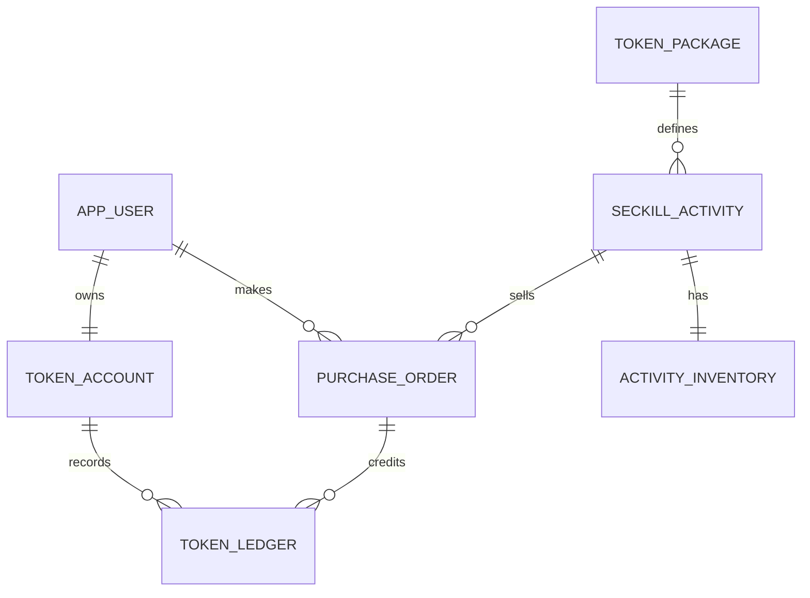

# TokenX：面向高并发秒杀与可复现压测的数据库设计 V3

> 状态：F0-3 设计评审稿（2026-10-20）；**非已实现或实测结果**。本文件以业务真实性、可测量的吞吐能力、交易正确性为约束，而不是复制任何开源仓库的表。
>
> 适用技术栈：Java 21、Spring Boot 4.x、MySQL 9.7（InnoDB）、Redis 8.x、Kafka 4.x。具体 Maven 依赖版本由项目锁定。
>
> 最重要的区分：入口请求 QPS ≠ 成功订单 TPS ≠ 完成交易 TPS。拒绝率很高时，即使入口 QPS 很高，也不能声称数据库支持同等订单 TPS。

## 1. 产品范围、性能假设与正确性不变量

### 1.1 首期真实业务
- 用户注册/登录，查看平台额度余额。
- 普通购买固定 Token 额度套餐，或者参加限时、有限库存的活动秒杀。
- 创建待支付订单，允许模拟支付成功或超时关闭。
- 支付确认、库存转为已售、用户 Token 额度入账及账本记录在**一个 MySQL 本地事务**中完成。
- 查看活动列表、商品详情、个人订单、个人资产流水。
- 首期不接真实支付网关、不支持已支付退款、不提现、不调用真实 AI 模型。未来接入时独立评审数据设计。

### 1.2 明确的业务规则
- 普通购买没有活动库存，允许重复购买；秒杀一人一活动最多**获得一次购买资格**，取消后不可再次参加（可迭代）。
- 每个活动对应一个确定套餐，发布活动时固定价格、到账额度及库存。
- 抢购返回“成功受理/排队中”不等于已生成订单；只有数据库确认后才返回有效订单状态。
- 所有金额用 BIGINT 表示分，平台额度用 BIGINT 整数；不使用 FLOAT/DOUBLE。
- 订单支付后不可回到待支付；同一订单只入账一次；同一订单的秒杀库存最多预占/释放一次。

### 1.3 压测负载：不要只测一个“卖完即拒绝”场景
| 场景 | 示例测试输入（非预期成绩） | 指标 |
| --- | --- | --- |
| 突发争抢 | 20,000 个不同用户争抢 1,000 份 | 入口 QPS、P99、限购、防超卖、成功受理比率 |
| 高有效写入 | 20,000 个不同用户，库存 20,000 | 有效订单 TPS、落库积压时延、DB 锁等待 |
| 并行活动 | 10 场同时抢购，总库存充足 | 多热点隔离与整体吞吐 |
| 混合业务 | 下单+模拟支付+关闭订单+用户查单 | 付款端到端 P99、锁竞争、订单与账本正确性 |
| 重试/故障 | 重复请求、重复消费、断开 Worker、重启 Redis | 幂等、数据差异、恢复能力 |

相同硬件/相同库存/相同实际成功订单数/相同请求分布下比较；报告压测配置、错误率、DB TPS、成功订单量，不用只展示峰值 QPS。

## 2. 核心架构：先设计好演进边界

**阶段 A（正确性与基线）**：HTTP -> Spring Boot -> MySQL 条件预占库存+创建订单（单库事务） -> 模拟支付+入账。此时不必为秒杀引入 Kafka 或额外请求表。

**阶段 B（减少数据库无效请求）**：Redis 缓存活动信息、限流、重复参与预校验；数据库依然是最终资格/库存权威来源。Redis 的过滤性能与失效/补偿必须测试。

**阶段 C（异步削峰，仅在指标有必要时）**：在同一次 Redis Lua 中完成准入预扣、记录 requestId、XADD Redis Stream；返回 `QUEUED` + requestId。Worker 从 Stream 消费，在 MySQL 中用条件更新、唯一索引创建订单并提交后 ACK。数据库是最终订单事实来源；重复消息必须幂等，失败需要补偿和可观察的最终状态。

**重要安全边界**：Redis Stream + AOF 仍不能宣称在所有崩溃/主从切换情况下零消息丢失。若产品承诺“受理成功必然持久”，必须在返回承诺前获得持久化确认（如先落 MySQL 准入记录），并评估其吞吐代价；否则明确排队状态可能失败，设计恢复/查询协议。不要把 Kafka 幂等生产者当成 Redis+MySQL 跨系统事务。

**阶段 D（有独立下游需求）**：订单确认之后的 Kafka 事件使用 `outbox_event` + 幂等消费者来保证业务事件可靠发布；不强行让 Kafka 进入初期同步交易事务。

## 3. 第一阶段确定的七张业务表



不设置真实支付流水表（模拟支付阶段由订单状态体现），不做分库分表，不提前创建消息消费日志等表。

### 3.1 `app_user`：低频写、按主键访问
- `id BIGINT UNSIGNED PRIMARY KEY AUTO_INCREMENT`
- `username VARCHAR(64) NOT NULL`, `password_hash VARCHAR(255) NOT NULL`, `status TINYINT NOT NULL`, `created_at DATETIME(3) NOT NULL`
- 唯一 `uk_user_name(username)`；如果确实提供邮箱注册/登录，再加 `email VARCHAR(254) NULL` 的唯一索引（明确 NULL 语义）。
- 不放 token_balance、累计订单数、累计签到数等热点/派生数据。

### 3.2 `token_package`：商品主数据，读多写少
- `id BIGINT UNSIGNED PRIMARY KEY AUTO_INCREMENT`
- `name VARCHAR(96)`, `credit_amount BIGINT UNSIGNED`, `list_price_cent BIGINT UNSIGNED`
- `status TINYINT`, `created_at/updated_at DATETIME(3)`
- 仅根据商品列表访问方式设计 `idx_package_status_id(status,id)`，避免按不查询的字段建索引。

### 3.3 `seckill_activity`：稳定活动配置
- `id BIGINT UNSIGNED PRIMARY KEY AUTO_INCREMENT`
- `package_id BIGINT UNSIGNED NOT NULL`, `activity_price_cent BIGINT UNSIGNED NOT NULL`, `credit_amount_snapshot BIGINT UNSIGNED NOT NULL`
- `start_at/end_at DATETIME(3) NOT NULL`, `status TINYINT NOT NULL`, `created_at/updated_at DATETIME(3)`
- 活动列表可考虑 `idx_activity_status_start(status,start_at,id)`，具体以真实查询和 `EXPLAIN ANALYZE` 为准。
- **不在该表更新秒杀库存/用户参与人数/实时成交额**，避免高频更新和管理查询共享一行。

### 3.4 `activity_inventory`：热点库存的最小物理边界
- `activity_id BIGINT UNSIGNED PRIMARY KEY`
- `total_stock INT UNSIGNED NOT NULL`, `available_stock INT UNSIGNED NOT NULL`, `reserved_stock INT UNSIGNED NOT NULL`
- `updated_at DATETIME(3) NOT NULL`
- `sold_stock = total_stock - available_stock - reserved_stock` 为**计算结果**，不持久维护第四份计数。
- 数据库约束：`CHECK (available_stock + reserved_stock <= total_stock)`；自然的 UNSIGNED 约束避免负数，但 Java/SQL 仍必须条件更新。
- **仅主键，无状态/库存辅助索引**。库存以 activity_id 点更新，频繁写入时每多维护一个二级索引都可能增加成本。
- 拆表只是隔离变动频率，不消灭同一活动的单行写锁。不同活动使用不同库存行，可并行更新。

预约（事务内）：
```sql
UPDATE activity_inventory
SET available_stock = available_stock - 1,
    reserved_stock = reserved_stock + 1
WHERE activity_id = ? AND available_stock > 0;
```
支付确认（事务内）：
```sql
UPDATE activity_inventory
SET reserved_stock = reserved_stock - 1
WHERE activity_id = ? AND reserved_stock > 0;
```
待支付取消（事务内）：
```sql
UPDATE activity_inventory
SET reserved_stock = reserved_stock - 1,
    available_stock = available_stock + 1
WHERE activity_id = ? AND reserved_stock > 0;
```
三者都必须与订单合法状态转移处于对应的本地事务中；不能以库存字段是否充足代替订单状态校验。

### 3.5 `purchase_order`：高写入、索引克制
- `id BIGINT UNSIGNED PRIMARY KEY AUTO_INCREMENT`：紧凑聚簇主键；V1 可直接用作订单编号，控制器授权检查不能只依靠 ID 不可猜。
- `request_id CHAR(36) CHARACTER SET ascii COLLATE ascii_bin NOT NULL`：客户端重试唯一键，后期若索引大小成为瓶颈可评估 BINARY(16)。
- `user_id BIGINT UNSIGNED NOT NULL`, `package_id BIGINT UNSIGNED NOT NULL`, `activity_id BIGINT UNSIGNED NULL`（普通订单无活动）
- `order_type TINYINT NOT NULL`, `package_name_snapshot VARCHAR(96) NOT NULL`, `credit_amount BIGINT UNSIGNED NOT NULL`, `pay_amount_cent BIGINT UNSIGNED NOT NULL`
- `status TINYINT NOT NULL`（例如 0=PENDING，1=PAID，2=CLOSED）, `expires_at DATETIME(3)`, `paid_at/closed_at DATETIME(3) NULL`, `created_at/updated_at DATETIME(3)`
- 必要索引：`UNIQUE(request_id)`，`UNIQUE(activity_id,user_id)`（MySQL 允许普通订单 activity_id=NULL 的重复组合）；`idx_order_user_time(user_id,created_at,id)`；`idx_order_timeout(status,expires_at,id)`。
- 活动订单要由数据库唯一键保证“一人一活动一次”，客户端生成不同 request_id 也不能绕过。
- 不默认再加 (activity_id,status)、(package_id)、(pay_amount_cent)、(user_id,status) 等索引，只有确有管理查询且验证获益后才加。
- 高频 `purchase_order` 插入是否添加对用户/活动的物理外键，需要明确取舍：外键保证参照完整性，但热路径会产生额外父记录共享锁；首版可选**逻辑外键 + 业务校验 + 集成测试**，而不是完全无约束。低频表和账户表可使用物理外键。

### 3.6 `token_account`：按用户隔离锁
- `user_id BIGINT UNSIGNED PRIMARY KEY`
- `available_balance BIGINT UNSIGNED NOT NULL DEFAULT 0`
- `updated_at DATETIME(3)`；未来真实模型消费需要额度冻结，再新增 `reserved_balance`，不要无需求提前维护。
- 用户注册时事务内创建账户；余额变更使用条件 UPDATE，避免读改写竞态。
- 不维护一行全局累计售出余额，以免所有支付集中写同一热点账户。

### 3.7 `token_ledger`：不可变流水
- `id BIGINT UNSIGNED PRIMARY KEY AUTO_INCREMENT`
- `user_id BIGINT UNSIGNED NOT NULL`, `biz_type TINYINT NOT NULL`, `biz_id BIGINT UNSIGNED NOT NULL`, `effect_type TINYINT NOT NULL`
- `delta BIGINT NOT NULL`, `balance_after BIGINT UNSIGNED NOT NULL`, `created_at DATETIME(3) NOT NULL`
- `UNIQUE(biz_type,biz_id,effect_type)` 保证同一订单的同一类入账只发生一次（全部字段 NOT NULL）；`idx_ledger_user_time(user_id,created_at,id)` 支持流水分页。
- 变更额度与写入流水必须在同一 DB 事务；为了避免重复更新，先占有唯一业务键/确认其结果再对账户作条件更新。支付重复请求应返回已处理状态。
- 仅存实际发生的交易事实，不保留每次失败的系统调用/HTTP 日志。

## 4. 事务顺序与锁的最小范围

### 4.1 同步秒杀基线
1. 校验活动时间、状态、用户权限；低频配置可以通过缓存读取，但事务里还要检查必要的权威条件。
2. 开启短事务，先以订单/唯一请求策略避免重复；活动-用户唯一约束为最终限制。
3. 条件更新 `activity_inventory` 预占 1 份；未更新到行则售罄。
4. 插入 `purchase_order` PENDING；出现唯一冲突则整事务回滚（库存更新也回滚）。
5. 提交事务后返回订单。**不要在行锁事务里发 Kafka、调用外部支付、做远程 HTTP、等待 Redis 网络或执行耗时统计**。

对于并发重复订单，不能把“检查是否存在然后 INSERT”当成最终保障。严禁任意吞掉 SQL 异常。

### 4.2 模拟支付（同库原子处理）
1. 启动事务，锁定/条件更新订单状态 PENDING -> PAID；支付超时关闭也只允许 PENDING -> CLOSED。
2. 活动订单结转 `reserved_stock - 1`；普通购买跳过库存。
3. 使用唯一业务键写 Token 流水，更新当前用户账户余额并记录 `balance_after`。
4. 提交事务；重复回调读取既有状态，不重复入账。
5. 对同一订单固定加锁顺序，减少死锁。应专门测试支付与取消竞争、双重模拟支付和跨订单钱包并发入账。

### 4.3 取消/超时关闭
- 对订单进行 PENDING -> CLOSED 条件状态转换，若受理成功则活动库存 `reserved - 1, available + 1`，同一事务提交。
- 超时扫描靠 `idx_order_timeout` 分页限批处理；不能单次全量加载；多 Worker 要使用可控并发策略。

## 5. Redis、Kafka 对数据模型的要求

### 5.1 Redis 的重点是降低失败请求对 MySQL 的压力
- 活动信息缓存（读多写少）、同一活动限流、售罄快速响应、Lua 原子准入。
- Redis 库存与数据库库存的关系需要定义：Redis 表示**临时准入量**，MySQL 是有效订单的最终权威数据；不把 Redis 当成另一份永久交易账本。
- 预扣失败、重复请求、超时补偿、Redis 丢数据后的恢复流程需要专项测试。

### 5.2 真正异步下单时才增加 `seckill_request`（可选但推荐做可靠业务追踪）
- `request_id` 唯一，`activity_id`、`user_id`、`status` (QUEUED/ORDERED/REJECTED/FAILED)、`order_id` nullable、`created_at/updated_at`
- 当需要**跨重启查询排队状态、审计已受理但尚未落单的请求**时，有独立存在价值；若只需要请求最终映射到订单且暂不承诺持久队列状态，可不建。
- 这张表并不自动修复 Redis Stream 丢消息。如果用户在 DB 请求记录落地前收到“已持久受理”承诺，仍有空窗，需要明确应答语义或同步持久化。

### 5.3 出现真正独立的下游事件时再增加 `outbox_event`
- 订单事务和 Outbox 记录使用同一个数据库提交；后台 Publisher 发送 Kafka，成功确认后标记完成；消费者自行幂等。
- 不让多个订单/钱包/库存业务模块因为“架构好看”拆开它们本可以在同一个 MySQL 事务完成的操作。

## 6. 分库分表与库存分桶：只基于瓶颈证据决策

| 方案 | 首期决定 | 何时触发 | 为什么 |
| --- | --- | --- | --- |
| 单库单表 + 必要索引 | **采用** | 现在 | 简单事务、查询路由、压测基线 |
| 读缓存与限流 | **按业务先后增加** | 活动读/无效抢购造成负载 | 优先挡住不必要 DB 请求 |
| Redis 原子预扣与异步削峰 | **优化阶段** | 大量有效下单请求造成写瓶颈 | 控制真正进入 DB 的节奏 |
| 活动库存分桶表 `inventory_bucket` | **暂不建** | 单库存行锁等待确实主导 TPS，且 Redis 削峰后仍不可接受 | 分散热点，但增加桶分配、取消释放、全局库存守恒和对账复杂度 |
| 订单按时间分区或水平分表 | **不做** | 大订单表索引/归档/写吞吐有可量化瓶颈 | 解决数据量/生命周期，不解决单活动库存热点 |
| 账本归档/分表 | **不做** | 持续增长让账本查询或存储无法达标 | 须保留用户维度查询与审计 |
| 分库 | **不做** | 单实例资源达到客观上限且其他手段无效 | 会破坏本地事务边界，远超首期复杂度 |

MySQL 9.7 InnoDB 分区限制：原生分区与外键不可兼容，且所有唯一键必须满足分区列约束；不能为了方便压测临时打开分区而不重新审视约束/查询。MySQL 官方文档：
- https://dev.mysql.com/doc/refman/9.7/en/partitioning-limitations-storage-engines.html
- https://dev.mysql.com/doc/refman/9.7/en/partitioning-overview.html

注意：`inventory_bucket` 会把一个活动的库存分散到 B 个可更新行，但库存抢购不能超分配，失败重试不能双释放，订单必须能找到原桶；热点真正解除前要证明业务锁和总量对账可实现。这应作为独立实验，不是默认架构。

## 7. 两层基准对比与验收数据

### 7.1 分阶段比较
- **A：MySQL-only**：所有合理请求入库检查；建基准。
- **B：Redis-filter + MySQL-sync**：过滤无效请求，继续同步落单。
- **C：Redis-Lua + Stream + MySQL-worker**：评估入口受理能力、队列积压与最终订单处理能力。`QUEUED` 不是订单完成，报告两个延迟。
- **D（条件触发）**：优化热点索引/库存分桶/批处理；必须证明比 C 有实测收益且不破坏一致性。

### 7.2 必报指标
- 客户端入口请求数、不同用户数、去重后受理数、最终成功订单数、支付成功数、拒绝数、超时数。
- 请求入口 QPS 与 HTTP P95/P99、有效订单 TPS、排队到订单确认 P95/P99、支付到账 P95/P99。
- MySQL CPU、redo/IO、连接池占用、InnoDB row lock wait、死锁数；Redis CPU、命令延迟、缓存命中率；Kafka/Stream backlog。
- 数据正确性断言：每活动有效订单不超总库存；活动库存 `available + reserved + paid_order_count = total`；每用户每活动最多一单；已支付订单对应恰好一笔入账；账本可核对账户余额。
- 测试配置要可复现：并发数、到达率、压测时长、库存、机器资源、Docker/Brew 部署、JVM 参数、数据预热、真实支付比例；统一预热和测量区间。
- 不能只测售罄以后持续被拒绝的请求，不能把秒杀受理 QPS 当订单持久化 TPS。

## 8. F0-3 交付和开发要求

1. 本文先作为 `docs/DATABASE_DESIGN.md` 的候选评审材料；Qoder 对照 `PROJECT_SPEC.md` 输出冲突与待确认事项，而不是直接批量建表。
2. **优先审查**：分离活动库存是否值得额外 join/查询缓存、模拟支付是否只用订单表、单场限购一次的业务规定、公开订单编号生成方式与索引成本。
3. 全局逻辑结构先审查；每个模块开发前分别提交 Flyway migration、Mapper/Service、单元和 MySQL 9.7 集成测试。
4. 不允许 AI 擅自安装新组件、更换版本、提前引入库存桶或分库分表、编造压测成绩。
5. 所有性能优化要有基线、可复现测试和一致性断言；失败必须停下来修复，不要跳过。

## 9. 参考资料（仅作为数据库特性证据）
- MySQL InnoDB locks: https://dev.mysql.com/doc/refman/9.7/en/innodb-locking.html
- MySQL transaction behavior: https://dev.mysql.com/doc/refman/9.7/en/innodb-transaction-isolation-levels.html
- MySQL clustered indexes: https://dev.mysql.com/doc/refman/9.7/en/innodb-index-types.html
- MySQL transaction overhead: https://dev.mysql.com/doc/refman/9.7/en/optimizing-innodb-transaction-management.html
- Redis Lua atomic execution: https://redis.io/docs/latest/develop/programmability/eval-intro/
